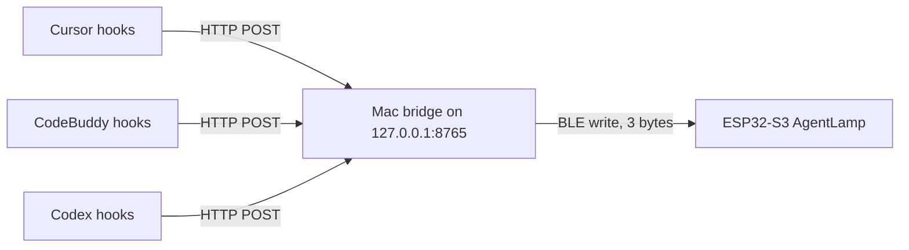

# AgentLamp

A desk lamp for an ESP32-S3. The onboard RGB LED shows whether Cursor, CodeBuddy, or Codex is working, has failed, or is waiting on you.

USB powers the board and carries the serial log. The status itself travels over Bluetooth Low Energy. There is no pairing step and nothing to select in System Settings.

## What the LED means

One color per app:

| App | Color |
| --- | --- |
| Cursor | cyan |
| CodeBuddy | amber |
| Codex | violet |

The pattern says what that app is doing. A higher pattern wins. If two apps share the winning pattern, the lamp cycles their colors about every 0.8 s.

| Pattern | Meaning |
| --- | --- |
| Fast double-blink, plus one short beep | Needs you. A question, or permission to run something. This beats the other patterns. |
| Slow pulse | Working. |
| Red blink | The turn ended with an error. |
| Dim white heartbeat, about every 4 s | Linked to the Mac, and every app is idle. The lamp is on and waiting. |
| Slow white breathe | USB power is on, but the Mac bridge is not connected. |

Brightness is capped in firmware (`DIM` in [AgentLamp.ino](AgentLamp.ino)) so blinks stay at the same low level as the working glow.

Press BOOT (GPIO 0) to print the link and the three states on serial, and to run a short color self-test.

## How a status gets to the board

None of the three apps publishes a live “agent is busy” socket. Each one can run a user hook when a turn starts, when it ends, and when it is blocked on you. The hook does not talk to the board.



1. A hook runs on the Mac and POSTs one JSON event to `http://127.0.0.1:8765/event`.
2. [bridge.py](bridge.py) keeps a set of session ids per app. The byte it sends is the strongest state among that app’s sessions: attention, then error, then working, then idle. A session with no further event for 15 minutes is dropped.
3. The bridge scans for the BLE name `AgentLamp` and writes three bytes to one GATT characteristic. The board notifies the same three bytes back.

The ESP32-S3 has BLE 5 only. Classic Bluetooth serial is not available, so the Mac must use CoreBluetooth. The bridge does that through Python `bleak`. Only one bridge can hold the connection. A second Mac must stop the first bridge before it connects.

### BLE contract

| | |
| --- | --- |
| Device name | `AgentLamp` |
| Service | `6f4c0001-8b3a-4c1e-9a2d-5e7b1c0a4d10` |
| Characteristic | `6f4c0002-8b3a-4c1e-9a2d-5e7b1c0a4d10` (read, write, write-without-response, notify) |
| Payload | 3 bytes: Cursor, CodeBuddy, Codex |
| Byte values | `0` idle, `1` working, `2` error, `3` attention |

No bonding and no passcode. The bridge connects to the first board advertising that name.

### Where each state comes from

Hooks return immediately and do not approve or block the agent. If the bridge is down, the hook gives up after 0.4 s and the agent continues.

**Cursor** (`~/.cursor/hooks.json`, user-level, so every workspace counts):

- `beforeSubmitPrompt` sets working.
- `stop` sets idle, or error when `status` is `error`.
- `beforeShellExecution` and `beforeMCPExecution` set attention when an unsandboxed call is still unfinished after about eight seconds (`AGENTLAMP_DEFER_S`). Cursor fires these hooks for every command, auto-run or waiting on an approval card, and the payload does not tell the two apart; deferring keeps routine commands "working" and only long-stuck calls blink. The deferral is keyed per call (`tool_use_id` on Cursor 3.24+, otherwise the command text), so one command finishing never cancels the timer of another that is still blocked on its approval card. `afterShellExecution` and `afterMCPExecution` disarm the timer and return the session to working. `postToolUseFailure` with a permission denial clears every pending timer for the session, so a denied card leaves no stray blink. The marker lives in `$TMPDIR/agentlamp-pending` and needs no cleanup.
- `preToolUse` / `postToolUse` for the tool name `AskQuestion` set attention, then working again.

Cursor has no hook that means “an approval card is on screen.” A turn that silently runs longer than the deferral still reads as "needs you". A reply that merely ends with a question mark is a finished turn, so the lamp goes idle. Cloud agents and Tab autocomplete do not move the lamp. Docs: [cursor.com/docs/hooks](https://cursor.com/docs/hooks).

**CodeBuddy Code CLI** (`~/.codebuddy/settings.json`, hooks beta since v1.16):

- `UserPromptSubmit` sets working. `Stop` sets idle.
- `Notification` with `permission_prompt` or `idle_prompt` (waiting about 60 seconds) sets attention.
- The next `PostToolUse`, `UserPromptSubmit`, or `Stop` clears attention.

The CodeBuddy IDE plugin is a different surface and is not covered. Docs: [codebuddy.ai/docs/cli/hooks](https://www.codebuddy.ai/docs/cli/hooks).

**Codex** (`~/.codex/hooks.json`), not the normal ChatGPT desktop chat:

- `UserPromptSubmit` sets working. `Stop` sets idle.
- `PermissionRequest` sets attention and returns no decision, so Codex still shows its own approval prompt. `PostToolUse` or `Stop` clears it.

Codex skips a new hook until you trust it with `/hooks`. The violet LED means Codex. The regular ChatGPT window has no documented busy signal. Docs: [developers.openai.com/codex/hooks](https://developers.openai.com/codex/hooks).

## Hardware

Generic ESP32-S3 dev board, native USB:

| Part | GPIO |
| --- | --- |
| RGB LED | 48 |
| Fallback single LED | 2 |
| BOOT button | 0, input with pull-up |
| Passive buzzer | 42, other leg to GND |

Board options match [sketch.yaml](sketch.yaml): `esp32:esp32:esp32s3`, USB CDC on boot, upload over the USB modem port. Serial is 115200.

## How to use

Commands below are run from the repository root.

### 1. Flash the board

Leave it plugged in over USB. With [arduino-cli](https://arduino.github.io/arduino-cli/) and the ESP32 core installed:

```bash
arduino-cli compile --fqbn "esp32:esp32:esp32s3:USBMode=default,CDCOnBoot=cdc,UploadMode=cdc,UploadSpeed=921600" AgentLamp
arduino-cli upload -p /dev/cu.usbmodemXXXX --fqbn "esp32:esp32:esp32s3:USBMode=default,CDCOnBoot=cdc,UploadMode=cdc,UploadSpeed=921600" AgentLamp
```

Use the modem port from `ls /dev/cu.usbmodem*`. After a reset the LED breathes white until a bridge connects.

Without the Mac, the serial monitor accepts a line of three digits (`0`–`3`) in the same order as the BLE payload, for example `1 0 3`. `s` prints the current bytes.

### 2. Run the bridge on the Mac that should drive the lamp

```bash
python3 -m venv AgentLamp/.venv
AgentLamp/.venv/bin/pip install -r AgentLamp/requirements.txt
AgentLamp/.venv/bin/python AgentLamp/bridge.py
```

Allow Bluetooth for the terminal or Python process when macOS asks. Leave the process running. The menu bar shows a lamp icon plus three marks, in order Cursor, CodeBuddy, Codex (no icon file means the text `Lamp` is used instead):

| Mark | State |
| --- | --- |
| `·` | idle |
| `●` | working |
| `?` | needs you |
| `!` | error |

Each app has Auto, Idle, Working, Needs you, and Error. Auto follows the hooks. The other four override that app until you choose Auto again. `--terminal` skips the menu and logs in the shell.

`GET http://127.0.0.1:8765/status` returns the link and the three states, plus how long since each app's last hook event and the bytes the board last echoed. `POST /event` with `{"app","session","state"}` is what the hooks send. `POST /override` with `{"app","state"}` sets a manual state; `state: null` clears it.

The icon in the menu bar is a plain template PNG. It lives in [lamp_icon.png](lamp_icon.png); [tools/make_icon.py](tools/make_icon.py) regenerates it. To check the state logic without hardware, run `python3 -m unittest discover -s AgentLamp/tests -p "test_*.py"`.

### 3. Install hooks on that same Mac

The hook script is [hook_report.py](hook_report.py). It uses `/usr/bin/python3` and does not need the virtualenv. Point every command at the copy of the script on that machine. Copying this Mac’s `hooks.json` onto another account will not work, because the path is absolute.

Cursor, `~/.cursor/hooks.json`:

```json
{
  "version": 1,
  "hooks": {
    "beforeSubmitPrompt": [{ "command": "/usr/bin/python3 /ABS/PATH/AgentLamp/hook_report.py cursor before-submit" }],
    "stop": [{ "command": "/usr/bin/python3 /ABS/PATH/AgentLamp/hook_report.py cursor stop" }],
    "beforeShellExecution": [{ "command": "/usr/bin/python3 /ABS/PATH/AgentLamp/hook_report.py cursor before-shell" }],
    "afterShellExecution": [{ "command": "/usr/bin/python3 /ABS/PATH/AgentLamp/hook_report.py cursor after-shell" }],
    "beforeMCPExecution": [{ "command": "/usr/bin/python3 /ABS/PATH/AgentLamp/hook_report.py cursor before-mcp" }],
    "afterMCPExecution": [{ "command": "/usr/bin/python3 /ABS/PATH/AgentLamp/hook_report.py cursor after-mcp" }],
    "preToolUse": [{ "command": "/usr/bin/python3 /ABS/PATH/AgentLamp/hook_report.py cursor pre-tool", "matcher": "AskQuestion" }],
    "postToolUse": [{ "command": "/usr/bin/python3 /ABS/PATH/AgentLamp/hook_report.py cursor post-tool", "matcher": "AskQuestion" }],
    "postToolUseFailure": [{ "command": "/usr/bin/python3 /ABS/PATH/AgentLamp/hook_report.py cursor post-tool-failure", "matcher": "Shell" }]
  }
}
```

CodeBuddy, inside `~/.codebuddy/settings.json`, a `hooks` object:

- `UserPromptSubmit` → `codebuddy prompt`
- `Stop` → `codebuddy stop`
- `Notification` matchers `permission_prompt` and `idle_prompt` → `codebuddy notify`
- `PostToolUse` → `codebuddy post-tool`

Codex, `~/.codex/hooks.json`:

- `UserPromptSubmit` → `codex prompt`
- `Stop` → `codex stop`
- `PermissionRequest` → `codex permission`
- `PostToolUse` → `codex post-tool`

Then run `/hooks` in Codex and trust the AgentLamp hook. Restart Cursor if a new prompt does not move the lamp.

### SSH remote workspace

When Cursor, CodeBuddy, or Codex runs against a workspace over SSH, the agent and its hooks execute on the remote machine. The remote hook cannot reach a bridge that only listens on the Mac. The fix is a reverse tunnel: remote port 8765 forwards back to the Mac, so the hook's unchanged `http://127.0.0.1:8765/event` lands on the Mac's bridge.

On the Mac, add one line to that host's block in `~/.ssh/config`:

```ssh-config
Host your-remote-host
  RemoteForward 18765 127.0.0.1:8765
```

The left port is on the remote machine, the right one is always the Mac's bridge. Pick any free remote port; 8765 itself is often taken (a busy remote port logs an SSH warning, the session itself is unaffected). Check with `ss -tln | grep <port>` on the remote.

VS Code-based remotes (CodeBuddy, Cursor) launch the system `ssh`, which reads this file, so their next connect opens the tunnel. Reconnect the remote window after editing; hooks and settings are not hot-reloaded either.

Then, on the remote machine:

1. Copy the hook script: `scp AgentLamp/hook_report.py your-remote-host:agentlamp/`.
2. Install the same hook events in the remote `~/.codebuddy/settings.json` (or the remote workspace's `.codebuddy/settings.json`), pointing at the remote copy of the script. When the tunnel does not use remote port 8765, prefix each command with `AGENTLAMP_BRIDGE=http://127.0.0.1:18765/event`.
3. Verify from the remote machine: `curl http://127.0.0.1:18765/status` should print the Mac bridge state, and a remote agent turn should move the lamp.

Notes:

- The remote needs Python 3 (the hook is standard library only) and remote port 8765 free. A busy port logs an SSH warning; the session itself is unaffected.
- Remote sessions report with their own session ids and merge with local ones; the strongest state still wins.
- The CodeBuddy IDE hook set (seven events) has no `Notification`. Over SSH from the IDE you get working and idle, but no attention blink for permission prompts; the CodeBuddy CLI hook set keeps `Notification`.
- Without a tunnel, run the bridge on `AGENTLAMP_HOST=0.0.0.0` and point the remote hook at the Mac with `AGENTLAMP_BRIDGE=http://<mac-ip>:8765/event`. That exposes the bridge on the network; prefer the tunnel.
- If the tunnel drops, remote hooks fail after 0.4 s and the agent continues. The lamp falls back on the 15-minute session timeout.

### Another Mac

Stop the bridge on this Mac, copy the repo to the other Mac, create the virtualenv, and start the bridge there. Install hooks on that Mac only if its own agents should drive the lamp. The board does not remember a host.
