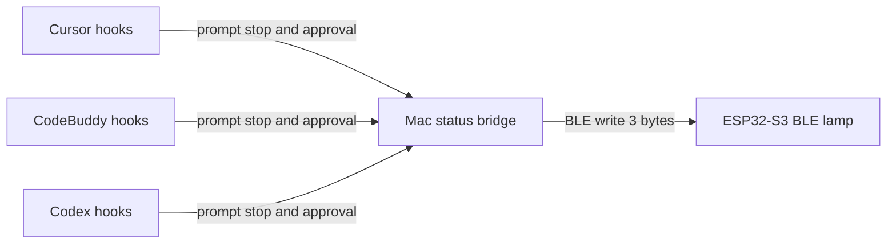

# Agent status lamp

Review this file before any firmware, hook, or Mac program is written. Reply with changes, or say to build it.

A generic ESP32-S3 on the desk links to this Mac over Bluetooth Low Energy. The onboard RGB LED shows whether Cursor, CodeBuddy, or ChatGPT/Codex is working, has failed, or is waiting on you.

## Hardware already on the board

From the sketches that already run here:

- Generic ESP32-S3, native USB (`/dev/cu.usbmodem…`)
- RGB LED on GPIO 48, fallback LED on GPIO 2
- BOOT button on GPIO 0
- Passive buzzer on GPIO 42 (wired for `BuzzerMelody`)

Same board pattern as [BuzzerMelody/sketch.yaml](BuzzerMelody/sketch.yaml): `esp32:esp32:esp32s3`, native USB CDC. Serial banner at 115200 from the first boot.

The S3 has BLE 5 only. Classic Bluetooth serial is not available, so the Mac must speak BLE (CoreBluetooth or a BLE library), not an SPP COM port.

## What the LED means

One color per app:

- Cursor: cyan
- CodeBuddy: amber
- ChatGPT / Codex: violet

The pattern says what that app is doing. A higher pattern wins. If two apps share the winning pattern, the lamp cycles their colors about every 0.8 s.

- **Needs you** (question, or permission to run something): fast double-blink of that app’s color. This beats working and error, so a blocked agent is not hidden behind one that is still running. Entering this state also gives one short beep on the buzzer.
- **Working**: slow pulse of that color.
- **Error**: blink red until the next prompt or a clean stop.
- **Connected and idle**: LED off.
- **USB powered but not linked to the Mac**: slow white breathe.

BOOT prints the link and the three app states on serial, and runs a short color self-test.

## How “working” is known

None of the three products publishes a live “agent is busy” socket. Each one that matters can run a user hook when a turn starts and when it ends. A small local bridge on the Mac turns those events into one BLE write.



- **Cursor** (IDE agent): user hook `~/.cursor/hooks.json`, not a project hook, so every workspace counts. `beforeSubmitPrompt` marks that conversation working. `stop` clears it. Input `status` is `completed`, `aborted`, or `error`. `error` lights red. The other two go idle. Docs: [cursor.com/docs/hooks](https://cursor.com/docs/hooks). These events apply to Agent Chat and Cmd+K. Cloud agents do not load every hook, so a cloud run may not move the lamp. Tab autocomplete is ignored on purpose.
- **CodeBuddy** (CodeBuddy Code CLI, hooks beta since v1.16): `UserPromptSubmit` starts working, `Stop` ends it, in `~/.codebuddy/settings.json`. Docs: [codebuddy.ai/docs/cli/hooks](https://www.codebuddy.ai/docs/cli/hooks). The CodeBuddy IDE plugin is not the same surface. v1 does not claim the IDE until that plugin fires the same hooks.
- **ChatGPT**: the normal ChatGPT desktop chat has no documented busy signal. Scraping its window with Accessibility breaks when the UI changes, so it is out of v1. **Codex** (CLI, and the Codex config under `~/.codex/hooks.json`) does have hooks. `UserPromptSubmit` starts a turn. `Stop` ends it. Both carry `session_id` and `turn_id`. Docs: [developers.openai.com/codex/hooks](https://developers.openai.com/codex/hooks). New hooks stay skipped until trusted with `/hooks`. The violet LED means Codex, not a browser ChatGPT tab.

Hooks return immediately and do not block the agent (`failClosed` stays off). They only POST a one-line event to `127.0.0.1` on the Mac. They never talk BLE themselves.

## When it needs you

A fourth state, `attention`, covers two waits: the agent asked a question, or it is blocked on permission to run a command. A plain reply that happens to end in a question mark is not this state. That is a finished turn (`stop` / `Stop`) and the lamp goes idle. Only a hook that means “blocked until the user acts” counts.

- **Codex** is the clean case. `PermissionRequest` runs only when Codex is about to show an approval (shell escalation, managed network, and similar). It does not run for commands that need no approval. The hook returns no decision, so the normal prompt still appears. Attention clears on `PostToolUse` for that call, on deny, or on `Stop`. Codex has no documented hook for a free-form question. If the turn just ends, the lamp goes idle.
- **CodeBuddy** uses `Notification`. Matcher `permission_prompt` means a permission dialog. Matcher `idle_prompt` means it has been waiting on the user for about 60 seconds. Both set attention. `elicitation_dialog` (MCP asking for input) is listed in the docs as not supported yet, so v1 does not depend on it. Attention clears on the next `PostToolUse`, `UserPromptSubmit`, or `Stop`.
- **Cursor** has no “waiting for approval” hook. That gap is an open request: [forum thread](https://forum.cursor.com/t/fire-a-hook-when-agent-waits-for-command-tool-approval/166947). v1 uses the closest signal and accepts one false pattern:
  - `beforeShellExecution` and `beforeMCPExecution` set attention only when `sandbox` is false (the Run / Reject path). A sandboxed auto-run stays “working”.
  - `afterShellExecution` / `afterMCPExecution` clears attention back to working.
  - Limit: an unsandboxed command that Cursor auto-runs still looks like “needs you” for the whole command, because the payload does not say whether a card is on screen. Returning `permission: "ask"` from the hook is not used to force a card. In current Cursor versions that answer is ignored in Auto-review and on some sandbox paths.
  - A structured question is `preToolUse` / `postToolUse` once the real tool name is logged on this Mac. The docs do not fix that name. Until it is confirmed, a Cursor question that is only text in the final message stays idle.

Attention is sticky per session until the matching clear event, `stop` / `Stop`, or the 15-minute timeout.

## Mac bridge

One menu-bar process, local only:

- Listens on localhost for hook events: app, session id, state (`working` / `attention` / `idle` / `error`).
- Keeps a set of session ids per app. The app’s byte is the strongest state among its sessions: attention, then error, then working, then idle. Two Cursor chats stay lit until both leave working.
- Drops a session that never receives `stop` after 15 minutes, so a crashed hook cannot leave the lamp on overnight.
- Holds the BLE connection. Writes a 3-byte characteristic: one byte per app, `0` idle, `1` working, `2` error, `3` attention.
- Shows idle, working, needs-you, and error in the menu bar, with a manual override per app for demos and for the ChatGPT window that has no hook.

Python plus `bleak` is enough for v1 (menu bar via `rumps`, or a plain terminal daemon plus a later menu). Swift and CoreBluetooth only if the Python menu proves awkward.

## BLE contract

- ESP32 is the peripheral. Name: `AgentLamp`.
- One custom service, one read/write/notify characteristic, 3 bytes as above.
- No pairing in v1. The bridge connects to the first advertising `AgentLamp`.
- The board applies the bytes, pulses or cycles colors, and notifies the same 3 bytes back so the Mac can confirm the link.
- Serial prints every state change.

## Where the code is

- Firmware: [AgentLamp/AgentLamp.ino](AgentLamp/AgentLamp.ino)
- Mac bridge: [AgentLamp/bridge.py](AgentLamp/bridge.py) on `127.0.0.1:8765`
- Hook script: [AgentLamp/hook_report.py](AgentLamp/hook_report.py), installed into `~/.cursor/hooks.json`, `~/.codebuddy/settings.json`, and `~/.codex/hooks.json`

Run the bridge from this repo:

```bash
AgentLamp/.venv/bin/python AgentLamp/bridge.py
```

Add `--terminal` to skip the menu bar. Codex skips a new hook until it is trusted with `/hooks`. The hook script itself uses `/usr/bin/python3` and does not need the virtualenv.
